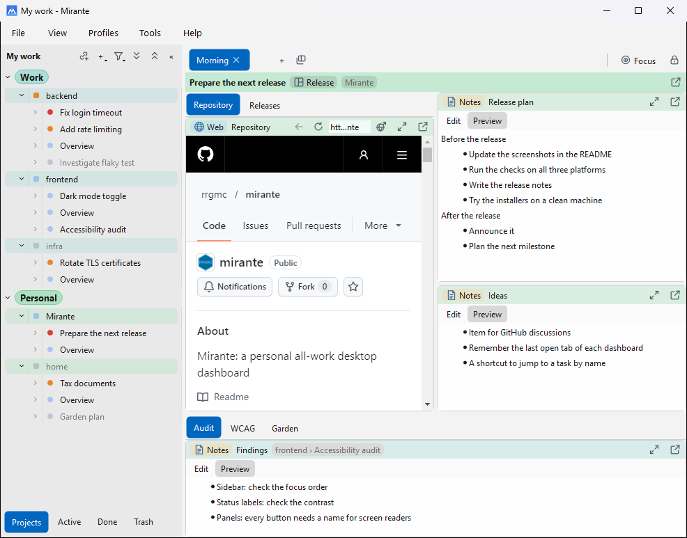

#  Mirante

Mirante is a personal desktop dashboard for all of one person's work. Work is organised in groups, projects and tasks. Each task collects its items on dashboards that the user can arrange freely. An item can be anything a module provides; the [modules](#modules) below are included. It is built with Qt 6 for Windows, macOS and Linux.

A workspace is stored as ordinary files and folders in the filesystem. This makes it compatible with file syncing apps such as Dropbox or Google Drive, so the same workspace can be used on several computers without a server.

## Modules

Mirante includes these modules. Each one provides one or more item types. [Item types](https://github.com/rrgmc/mirante-core/blob/master/docs/item-types.md) describes them in detail, and Help > Modules lists them in the app.

| Module | Item types |
|---|---|
| [Claude](https://github.com/rrgmc/mirante-modules-work/blob/master/claude/README.md): Claude sessions on claude.ai, and the Claude agents on this device | Claude session (web), Claude agents |
| [Documents](https://github.com/rrgmc/mirante-modules/blob/master/document/README.md): Markdown, text and PDF files | Document (web address), Document (workspace file), Document (project file) |
| [Folder](https://github.com/rrgmc/mirante-modules/blob/master/folder/README.md): a project's folder, with its Git state and shortcuts to a terminal and an editor | Folder / terminal |
| [GitHub](https://github.com/rrgmc/mirante-modules-work/blob/master/github/README.md): github.com or GitHub Enterprise Server | GitHub PR (summary), GitHub PR (page), GitHub PR List, GitHub Actions Run, GitHub Actions Run List, GitHub Issue (summary), GitHub Issue (page), GitHub Issue List, GitHub Status |
| [GitLab](https://github.com/rrgmc/mirante-modules-work/blob/master/gitlab/README.md): a GitLab server | GitLab MR (summary), GitLab MR (page), GitLab MR List, GitLab CI Pipeline, GitLab CI Pipeline List, GitLab Issue (summary), GitLab Issue (page), GitLab Issue List, GitLab Status |
| [Image](https://github.com/rrgmc/mirante-modules/blob/master/image/README.md): screenshots or diagrams, with an optional link and memo | Image |
| [Jira](https://github.com/rrgmc/mirante-modules-work/blob/master/jira/README.md): a Jira site | Jira Issue (summary), Jira Issue (page), Jira List |
| [Notes](https://github.com/rrgmc/mirante-modules/blob/master/notes/README.md): Markdown notes, kept in the task's file | Notes |
| [System](https://github.com/rrgmc/mirante-modules/blob/master/system/README.md): this computer's CPU use, free memory and free disk space | System Resources |
| [Web](https://github.com/rrgmc/mirante-modules/blob/master/web/README.md): any web page | Web page |

## Adding more modules

Modules are compiled into Mirante, not loaded while it runs. A module cannot be installed into a Mirante that is already built. To use other modules, you build a Mirante of your own that lists them. [Why modules are compiled in](https://github.com/rrgmc/mirante-core#why-modules-are-compiled-in) gives the reasons, including that macOS would refuse modules loaded from elsewhere.

That is what the repositories behind Mirante are for:

- [`mirante-core`](https://github.com/rrgmc/mirante-core) holds the app itself and the interface that modules use.
- [`mirante-modules`](https://github.com/rrgmc/mirante-modules) and [`mirante-modules-work`](https://github.com/rrgmc/mirante-modules-work) hold the modules above. Anyone can keep modules in a repository of their own.
- This repository holds only a list, `mirante.json`, of the core and the modules to build, each pinned to a release. GitHub Actions builds and publishes the result.

[`mirante-app-template`](https://github.com/rrgmc/mirante-app-template) makes a repository like this one, with the modules you choose, and builds your Mirante on GitHub. [Writing a module](https://github.com/rrgmc/mirante-core/blob/master/docs/writing-a-module.md) says how to make a module, and [`mirante-modules-samples`](https://github.com/rrgmc/mirante-modules-samples) has small examples.

A module runs inside Mirante with everything Mirante can reach, including your tokens and web logins, so add only modules whose authors you trust. Every build of Mirante is the same app, so a build of your own replaces this one when you install it, and keeps your settings and workspaces.

## Installing

Each [release](https://github.com/rrgmc/mirante/releases) has three files. [CHANGELOG.md](CHANGELOG.md) says what changed in each.

- **Windows 10 and 11, 64-bit:** `mirante-<version>-win64.exe`. Run it and follow the steps. The setup is not signed, so the first time Windows may say that it protected your PC. Choose **More info**, then **Run anyway**. Mirante is then in the Start menu, and Settings > Apps uninstalls it.
- **macOS 12 or later, Apple silicon and Intel:** `mirante-<version>-macos.dmg`. Open it and drag Mirante to Applications. The app is signed and notarised, so it opens without a warning.
- **Ubuntu 24.04 or later, 64-bit:** `mirante_<version>_amd64.deb`. Install it with `sudo apt install ./mirante_<version>_amd64.deb`. Mirante is then in the applications menu, and `mirante` starts it from a terminal. The package installs into `/opt/mirante`, with its own Qt, and adds an AppArmor profile so the web pages keep Chromium's sandbox. `sudo apt remove mirante` removes it.

### First start

1. Mirante opens with the sample data, which shows what it can do. Changes to it are not saved.
2. Choose File > New Workspace… and pick an empty folder for your own data. A folder synced by Dropbox, OneDrive or iCloud Drive makes the workspace available on your other computers. Logins and tokens stay on each computer.
3. Choose File > New Group…, then add projects, tasks and their items from the sidebar's context menu. File > New Task from Link… makes a task from a Jira issue or a merge request link.
4. To see GitLab or Jira status, choose Profiles > Manage Profiles…, select the module under the profile, such as GitLab under Default, and enter the server and a token. Tokens are kept in the system's keychain.
5. `Alt+Shift+D`, or `Control+Shift+D` on macOS, hides Mirante to the system tray, or the menu bar on macOS, and shows it again from any application. Closing the window quits Mirante. To keep it running in the tray instead, turn on "Closing the window keeps Mirante running in the tray" in Tools > Settings…, or Mirante > Settings… on macOS.

The [user interface](https://github.com/rrgmc/mirante-core/blob/master/docs/ui.md) describes everything in detail.

## Building

[BUILDING.md](BUILDING.md) says how to build, test and package Mirante.

## Author

Rangel Reale <realerangel@gmail.com>

## License

Mirante is released under the [MIT License](LICENSE).
