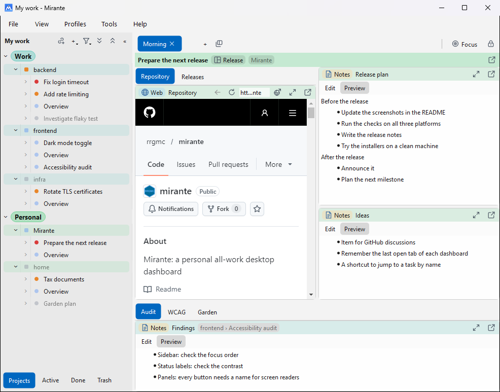

#  Mirante

Mirante is a personal desktop dashboard for all of one person's work. Work is organised in groups, projects and tasks. Each task collects its items on dashboards that the user can arrange freely. An item can be anything a module provides; the [modules](#modules) below are included. It is built with Qt 6 for Windows, macOS and Linux.

A workspace is stored as ordinary files and folders in the filesystem. This makes it compatible with file syncing apps such as Dropbox or Google Drive, so the same workspace can be used on several computers without a server.

The design is in [docs/README.md](docs/README.md).

## Modules

Mirante includes these modules. Each one provides one or more item types. [Item types](docs/item-types.md) describes them in detail, and Help > Modules lists them in the app.

| Module | Item types |
|---|---|
| [Claude](src/modules/claude/README.md): Claude sessions on claude.ai | Claude session (web) |
| [Documents](src/modules/document/README.md): Markdown, text and PDF files | Document (web address), Document (workspace file), Document (project file) |
| [Folder](src/modules/folder/README.md): a project's folder, with its Git state and shortcuts to a terminal and an editor | Folder / terminal |
| [GitHub](src/modules/github/README.md): github.com or GitHub Enterprise Server | GitHub PR (summary), GitHub PR (page), GitHub PR List, GitHub Actions Run, GitHub Actions Run List, GitHub Issue (summary), GitHub Issue (page), GitHub Issue List |
| [GitLab](src/modules/gitlab/README.md): a GitLab server | GitLab MR (summary), GitLab MR (page), GitLab MR List, GitLab CI Pipeline, GitLab CI Pipeline List, GitLab Issue (summary), GitLab Issue (page), GitLab Issue List |
| [Image](src/modules/image/README.md): screenshots or diagrams, with an optional link and memo | Image |
| [Jira](src/modules/jira/README.md): a Jira site | Jira Issue (summary), Jira Issue (page), Jira List |
| [Notes](src/modules/notes/README.md): Markdown notes, kept in the task's file | Notes |
| [Web](src/modules/web/README.md): any web page | Web page |

## Installing

Each [release](https://github.com/rrgmc/mirante/releases) has three files:

- **Windows 10 and 11, 64-bit:** `mirante-<version>-win64.exe`. Run it and follow the steps. The setup is not signed, so the first time Windows may say that it protected your PC. Choose **More info**, then **Run anyway**. Mirante is then in the Start menu, and Settings > Apps uninstalls it.
- **macOS 12 or later, Apple silicon and Intel:** `mirante-<version>-macos.dmg`. Open it and drag Mirante to Applications. The app is signed and notarised, so it opens without a warning.
- **Ubuntu 24.04 or later, 64-bit:** `mirante_<version>_amd64.deb`. Install it with `sudo apt install ./mirante_<version>_amd64.deb`. Mirante is then in the applications menu, and `mirante` starts it from a terminal. The package installs into `/opt/mirante`, with its own Qt, and adds an AppArmor profile so the web pages keep Chromium's sandbox. `sudo apt remove mirante` removes it.

### First start

1. Mirante opens with the sample data, which shows what it can do. Changes to it are not saved.
2. Choose File > New Workspace… and pick an empty folder for your own data. A folder synced by Dropbox, OneDrive or iCloud Drive makes the workspace available on your other computers. Logins and tokens stay on each computer.
3. Choose File > New Group…, then add projects, tasks and their items from the sidebar's context menu. File > New Task from Link… makes a task from a Jira issue or a merge request link.
4. To see GitLab or Jira status, open the module's settings in the Profiles menu, such as Profiles > Default (default) > Modules > GitLab > General Configuration…, and enter the server and a token. Tokens are kept in the system's keychain.
5. `Alt+Shift+D`, or `Control+Shift+D` on macOS, hides Mirante to the system tray, or the menu bar on macOS, and shows it again from any application. Closing the window quits Mirante. To keep it running in the tray instead, turn on "Closing the window keeps Mirante running in the tray" in Tools > Settings…, or Mirante > Settings… on macOS.

The [user interface](docs/ui.md) describes everything in detail.

## Building

[BUILDING.md](BUILDING.md) says how to build, test and package Mirante.

## Author

Rangel Reale <realerangel@gmail.com>

## License

Mirante is released under the [MIT License](LICENSE).
